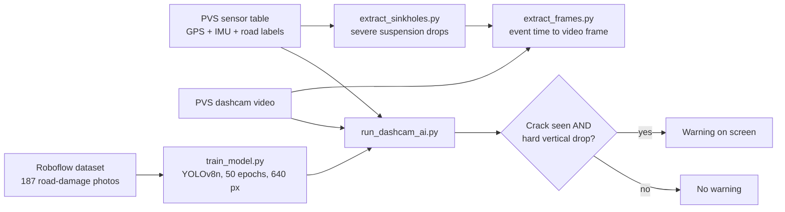

# Road-Hazard Detection with Vision and Sensor Fusion

**A YOLOv8 camera detector cross-checked against a suspension accelerometer. A warning is raised only when both agree.**


Prototype that combines a YOLOv8n road-hazard detector with suspension accelerometer data. The camera alone gives false alarms on harmless cracks, and the accelerometer alone cannot tell what the wheel hit. The warning needs a crack in view and a hard vertical drop at the same moment.

Built as a team of 3 in the Renault Nissan Technology and Business Centre India collaboration program at SRM (Jan to Apr 2026).

## My contribution

The pipeline was originally built by my project team (team of 3). My part:

- Re-trained the YOLOv8n detector and evaluated it on a held-out test split (results below).
- Fixed a frame-counter bug in `run_dashcam_ai.py` (the video was seeked to minute 5 but the counter restarted at 0, so the sensor lookup was about 300 seconds off).
- Wrote this documentation.
- Later clean-up (November 2026, with an AI coding assistant): removed the hard-coded Windows paths, moved the logic into a small tested module, and added the tests. Details in the change log.

## Pipeline



1. `extract_sinkholes.py` merges the PVS GPS/IMU data with bad-road labels and keeps severe suspension-drop events.
2. `extract_frames.py` converts event timestamps to video frames and crops the road area, to look at what the car drove over at each event.
3. `train_model.py` fine-tunes YOLOv8n (50 epochs, 640 px) on the Sinkhole_Vision_Fusion dataset (187 images, classes Concentric_Crack and Pothole).
4. `run_dashcam_ai.py` runs the detector on the video, looks up the matching accelerometer reading and shows a warning when both conditions hold.

A separate script, `news_risk_scan.py`, reads the Google News feed and lists Indian cities with recent road-collapse or excavation headlines. It was written by my teammate Mushir and is not connected to the camera and accelerometer loop.

The rules themselves are in [`fusion.py`](fusion.py): which rows count as severe drops, how a timestamp maps to a frame, which sensor reading belongs to a frame, and when to warn. Paths and thresholds are in [`config.py`](config.py).

## Results (my re-training run, test split)

| Metric | Value |
|---|---|
| mAP50 | 0.910 |
| mAP50-95 | 0.651 |
| Precision | 0.853 |
| Recall | 0.875 |

Test split: 15 images, 16 Concentric_Crack instances. The run is saved with its outputs in `train_and_evaluate.ipynb`.

## Detector dataset

| Split | Images | Concentric_Crack boxes | Pothole boxes |
|---|---|---|---|
| Train | 142 | 114 | 47 |
| Validation | 30 | 31 | 0 |
| Test | 15 | 16 | 0 |

The images are photographs of sinkholes, collapsed road and potholes, resized to 512 x 512. They are not frames from the PVS dashcam video. The dataset is not copied into this repository, because many of the photos are third-party pictures. Download it from [Roboflow Universe](https://universe.roboflow.com/xxx-r4bdj/sinkhole_vision_fusion/dataset/1) (the notebook does this), then check it with `python tools/check_dataset.py path/to/Sinkhole_Vision_Fusion-1`.

## Run it

```bash
pip install -r requirements.txt

python extract_sinkholes.py                 # step 1, needs the PVS dataset in Data/
python extract_frames.py                    # step 2
python train_model.py --data path/to/data.yaml
python run_dashcam_ai.py --weights runs/detect/train/weights/best.pt

python news_risk_scan.py                    # optional, needs internet
```

Every script takes `--help`. Paths can also be set with `ROAD_HAZARD_DATA_DIR`, `ROAD_HAZARD_DATASET_YAML` and `ROAD_HAZARD_WEIGHTS`. Use `--no-display --save out.mp4` to run the live loop without a window.

## Tests

```bash
pip install -r requirements-dev.txt
pytest
```

19 tests on small synthetic data. They need no dataset, weights, GPU or network. They cover the severe-drop filter, the timestamp and frame conversions, the frame-counter bug, the sensor lookup, the warning rule, the whole live loop with a fake detector on a generated video, and the news headline filter.

## Limitations

- The validation and test splits contain no Pothole boxes, so pothole detection was not evaluated.
- The test set is very small, so scores are noisy.
- **Domain gap.** The detector was trained and tested on photographs of large sinkholes and road damage. The live loop runs it on PVS dashcam frames, which look different. The 0.91 mAP50 says nothing about how well it works on that video. This was not measured.
- A duplicate check (`tools/check_dataset.py`, 16 x 16 average hash) found no test image copied from the training set, and one validation image that is. It cannot find different photos of the same scene.
- "Sinkhole" events are hard suspension drops on bad roads (a proxy). No real sinkhole data was used.
- The acceleration threshold in the live loop (-5.0) differs from the one used for event extraction (median minus 3.8) and has not been validated.
- The video and the sensor log are assumed to start at the same moment. That alignment has not been checked against the PVS data.
- The frame-counter fix and the refactored scripts are tested on synthetic data only. They were not re-run against the PVS video.
- The warning fires when the wheel is already on the hazard. It is a detection, not a prediction ahead of time.

## Dataset and data

- Detector data: Roboflow, Sinkhole_Vision_Fusion v1, CC BY 4.0.
- Sensor and video data: PVS driving dataset (not included).
- Team repository with the original scripts: [mushir2004/Sinkhole_Detection_Project](https://github.com/mushir2004/Sinkhole_Detection_Project).

## Change log

**November 2026: clean-up** (done with an AI coding assistant, see the commit history)

- Replaced the hard-coded `D:\` and `E:\` paths with `config.py`, environment variables and command-line options
- Moved the pipeline rules into `fusion.py` and added tests and a CI workflow
- The sensor lookup is now a binary search. Before, the whole sensor table was sorted again for every video frame
- The on-screen text now says "POSSIBLE ROAD HAZARD". The old text claimed a sinkhole, which this data cannot show
- Renamed `test_model.py` to `predict_image.py`, because it predicts on one image and is not a test
- Added `--no-display` and `--save` to the live loop
- Added the team's news scan as `news_risk_scan.py`, with its headline filter split out and tested
- Added the dataset table, the duplicate check and the domain-gap limitation
